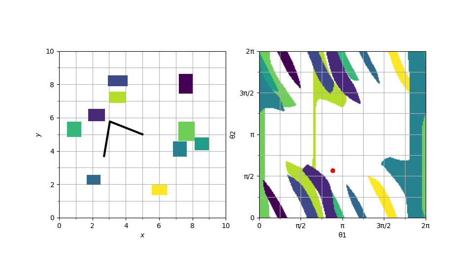

# Co-SDF: Learning Signed-Distance-Correlated Neural Fields in Configuration Space Without Distance Supervision

We propose Co-SDF, a correlated signed distance neural representation defined directly in C-space. 
The model learns a continuous scalar field over joint configurations from binary collision labels without requiring explicit supervision of true C-space signed distance-to-collision. 
Each configuration is mapped to control-point embeddings via forward kinematics, and a 1-Lipschitz neural architecture trained with hinge Kantorovich–Rubinstein (hKR) and Eikonal regularization promotes smooth and distance-consistent behavior.

## Installation

To install the necessary dependencies, run:

```bash
pip install -r requirements.txt
```

> [!NOTE]
> For OMPL-based RRT baselines, ensure `ompl` Python bindings are installed in your environment.

---

## Project Structure

- **2Dexample/**: Core scripts for the 2D arm environment.
    - `data_generator.py`: Configuration space sampling.
    - `train_lip.py`: Training the 1-Lipschitz NDF.
    - `correlation.py`, `escape.py`, `trajectory_benchmark.py`: Standard 2D evaluation suite.
- **franka_fr3/**: Robust implementation for the 7-DOF Franka FR3 arm.
    - `data_generator.py`: Configuration space sampling.
    - `train_lip.py`: Training the 1-Lipschitz NDF.
    - `correlation.py`, `escape.py`, `trajectory_benchmark.py`: Standard 7D evaluation suite.

---

## 2D Intensive Evaluation & Benchmarking

The 2D environment serves as the primary testbed for NDF quality and optimization performance across three key standard experiments.

### 1. Correlation Test (Numerical Quality)
Evaluates the numerical consistency between NDF predictions and Ground Truth C-space SDF using Spearman correlation and classification metrics (F1, Accuracy).
```bash
cd 2Dexample
python correlation.py --world obs10 --n-samples 3000
```

### 2. Escape Test (Gradient Quality)
Evaluates NDF gradient quality at the C-space boundaries. Samples are placed at the collision boundary and moved along the gradient to "escape" collision.
```bash
python escape.py --world obs10 --n-samples 200
```

### 3. Trajectory Optimization Benchmark
Compares NDF-based optimization against Workspace SDF baselines (IPOPT, OSQP, qpOASES) across 100 random planning problems.
```bash
python trajectory_benchmark.py --world obs10 --samples 100 --n_waypoints 30
```

### Visualization (Paper-Ready)
Generate high-quality figures for specific trajectories.
```bash
python trajectory_fig.py --world obs10 --path_idx 0
```

---

## Franka FR3 (7-DOF) Intensive Evaluation

The 7-DOF pipeline is evaluated using higher-dimensional variants of the core experiments.

### 1. Correlation Test (Numerical Quality)
Evaluates NDF distance accuracy against MuJoCo-based approximate ground truth C-space distance.
```bash
cd franka_fr3
python correlation.py --world obs30 --samples 3000
```

### 2. Escape Test (Gradient Quality)
Evaluates the ability of the NDF gradient to guide the 7-DOF robot out of complex collision configurations.
```bash
python escape.py --world obs30 --samples 200
```

### 3. Trajectory Optimization Benchmark
Comprehensive evaluation of NDF-based trajectory refinement against Workspace SDF across standard scenarios (e.g., bookshelf).
```bash
python trajectory_benchmark.py --world bookshelf --samples 100 --n_waypoints 30
```

---

## Visualization

| RRT Path | Optimized Path (NDF) |
| :---: | :---: |
|  |  |
|  |  |
|  |  |

