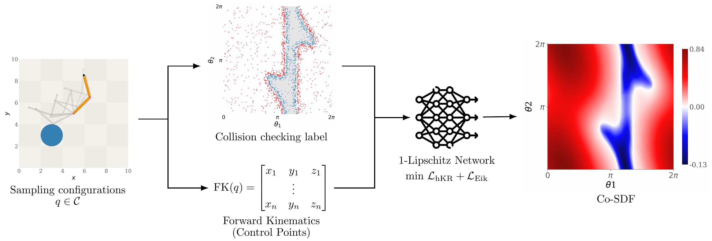
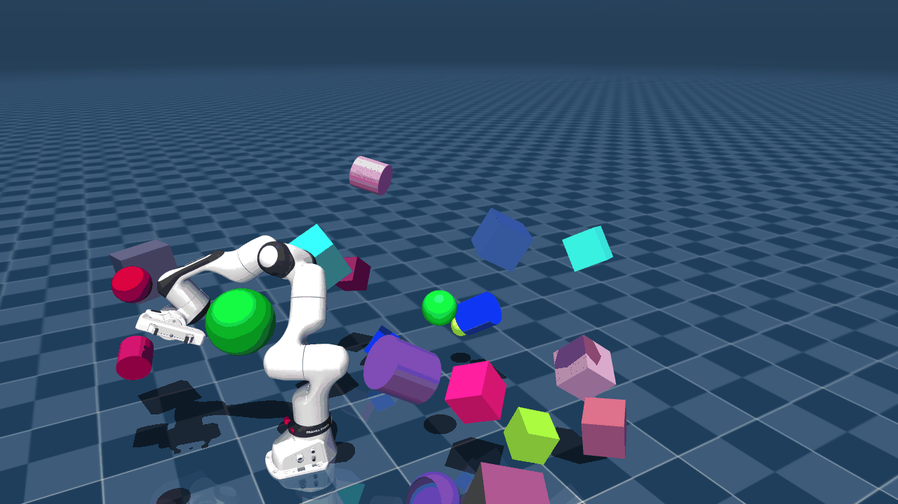
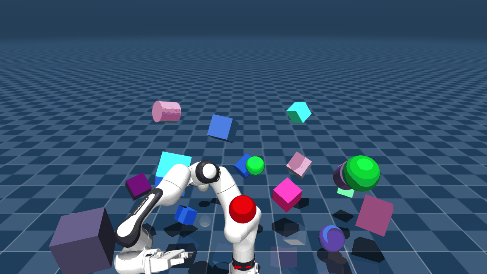

**# Co-SDF: Learning Signed-Distance-Correlated Neural Fields in Configuration Space Without Distance Supervision**

**Accepted at IEEE/RSJ International Conference on Intelligent Robots and Systems (IROS 2026)**

We propose Co-SDF, a correlated signed distance neural representation defined directly in C-space. 
The model learns a continuous scalar field over joint configurations from binary collision labels without requiring explicit supervision of true C-space signed distance-to-collision. 
Each configuration is mapped to control-point embeddings via forward kinematics, and a 1-Lipschitz neural architecture trained with hinge Kantorovich–Rubinstein (hKR) and Eikonal regularization provides stable gradients for trajectory optimization.



## Installation

```bash
pip install -r requirements.txt
```

> [!NOTE]
> Trajectory planning additionally requires OMPL, MuJoCo, CasADi, L4CasADi, IPOPT, and NLopt.

---

## Project structure

- `2Dexample/`: 2-DoF data generation, training, evaluation, and trajectory planning.
- `franka_fr3/`: 7-DoF Franka FR3 data generation, training, evaluation, and trajectory planning.
- `data_generator.py`: generates collision-labelled configurations.
- `train_lip.py`: trains the 1-Lipschitz Co-SDF model.
- `correlation.py`: evaluates field correlation and collision classification.
- `escape.py`: evaluates optimization-based and sampling-based collision escape.
- `traj_planner.py`: runs RRT initialization and Co-SDF trajectory optimization.
- `traj_solver.py`: contains the IPOPT and NLopt trajectory solvers.
- `traj_verify.py`: evaluates trajectory safety, length, and smoothness.

---

**## 2-DoF**

```bash
cd 2Dexample
python data_generator.py --world block_world1 --n-train 5000
python train_lip.py --world block_world1 --model cosdf --n-layers 10 --n-hidden 256 --epochs 200 --batch-size 200 --learning-rate 5e-4 --loss-margin 1e-2 --loss-lambda 100 --eikonal-weight 0.1
```

**## 7-DoF**

```bash
cd franka_fr3
python data_generator.py --world obs10 --n_points 500000
python train_lip.py --world obs10 --n-layers 20 --n-hidden 512 --epochs 200 --batch-size 2048 --learning-rate 5e-4 --loss-margin 1e-2 --loss-lambda 100 --eikonal-weight 0.1 --eikonal-target 1.0
```

### Training parameters

| Parameter | Meaning |
| :--- | :--- |
| `--world` | Scene and dataset name. |
| `--model` | Model type; `cosdf` selects Co-SDF. |
| `--n-layers` | Number of hidden Lipschitz layers. |
| `--n-hidden` | Width of each hidden layer. |
| `--epochs` | Number of training epochs. |
| `--batch-size` | Number of configurations per training batch. |
| `--learning-rate` | Adam learning rate. |
| `--loss-margin` | Margin used by the hKR loss. |
| `--loss-lambda` | Weight of the classification term in the hKR loss. |
| `--eikonal-weight` | Weight of the Eikonal regularization term. |
| `--eikonal-target` | Target norm of the field gradient in the 7-DoF model. |

## Experiments

### Correlation

Evaluates the agreement between Co-SDF predictions and reference distances.

2D Example

```bash
cd 2Dexample
python correlation.py --world block_world1 --n-samples 2000
```

Franka

```bash
cd franka_fr3
python correlation.py --world obs10 --samples 2000
```

### Escape

Evaluates whether Co-SDF can guide configurations out of collision.

2D Example

```bash
cd 2Dexample
python escape.py --world block_world1 --n-samples 1000
```

Franka

```bash
cd franka_fr3
python escape.py --world obs10 --n-samples 1000
```

**### Trajectory Optimization**

Trajectory Optimization an RRT or RRTconnect path using Co-SDF collision constraints and smoothness objectives.

Toy example for 2D Example

```bash
cd 2Dexample
python traj_planner.py --world block_world1 --solver ipopt --n_waypoints 30 --safety_margin 0.02 --max_iter 200
```

Franka Clutter

```bash
cd franka_fr3
python traj_planner.py --world obs10 --solver slsqp --n_waypoints 30 --safety_margin 0.02 --max_iter 200 --playback_fps 30
```

Franka Bookshelf

```bash
cd franka_fr3
python shelf_planner.py --world bookshelf --solver ipopt --n_waypoints 30 --safety_margin 0.02 --max_iter 200 --playback_fps 30
```

### Trajectory-planning parameters

| Parameter | Meaning |
| :--- | :--- |
| `--world` | Scene name. The planner loads the corresponding scene and trained model. |
| `--solver` | `slsqp` uses NLopt SLSQP; `ipopt` uses CasADi, L4CasADi, and IPOPT. |
| `--n_waypoints` | Number of optimized joint configurations. More waypoints increase resolution and computation. |
| `--safety_margin` | Minimum Co-SDF value required at every waypoint. A larger value keeps the trajectory farther from the predicted collision boundary. |
| `--max_iter` | Maximum number of solver iterations. |
| `--playback_fps` | FR3-only MuJoCo playback rate. It does not affect optimization. |


## Visualization

| RRT Path | Optimized Path (NDF) |
| :---: | :---: |
|  |  |
|  |  |
|  |  |
